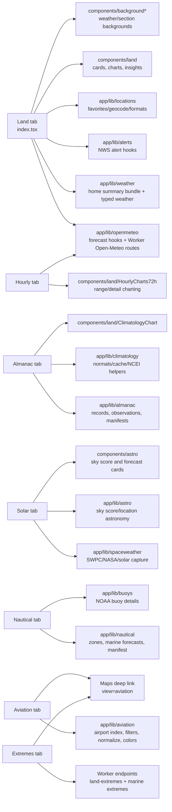
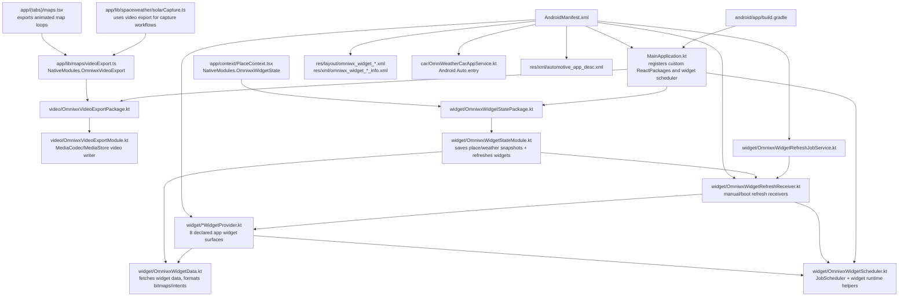

# OMNIwx File Relationship Architecture

Last updated: September 15, 2026

This document maps how the repository files relate to each other. It complements the higher-level platform view in [app-architecture.md](app-architecture.md) and the deeper radar view in [radar-architecture.md](radar-architecture.md).

It is also a dead-code hunting aid. The static graph below was built from local `import`, `export from`, and `require(...)` references across `app/`, `components/`, `hooks/`, `styles/`, `constants/`, `scripts/`, `omniwx-api/src/`, and `omniwx-api/scripts/`. Static analysis cannot see every Expo route, native manifest entry, runtime string route, or planned backend hook, so removal candidates are intentionally labeled by confidence.

## Repository System Map

```mermaid
flowchart TB
  Package["package.json\nExpo app scripts and JS dependency root"]
  ExpoConfig["app.json + app.config.js\nExpo identity, plugins, build-time API env"]
  TSConfig["tsconfig.json + eslint.config.js\nType/lint policy"]

  subgraph Mobile["Mobile app source"]
    AppRoutes["app/\nExpo Router routes and app-local libraries"]
    Components["components/\nReusable UI, map chrome, charts, boot, backgrounds"]
    Hooks["hooks/\nLegacy/shared color-scheme hooks"]
    Styles["styles/ + constants/\nTheme tokens, typography, tab colors"]
    Assets["assets/\nBrand, weather video, tutorial, backgrounds, map thumbnails"]
  end

  subgraph Android["Native Android shell"]
    AndroidGradle["android/app/build.gradle\nNative build config"]
    Manifest["AndroidManifest.xml\nMainActivity, widgets, Android Auto, permissions"]
    NativeModules["Kotlin ReactPackages\nOmniwxVideoExport + OmniwxWidgetState"]
    Widgets["Kotlin widget providers\nCurrent, Radar, SkyScore, Aviation, Climatology"]
    Car["Android Auto service\nOmniWeatherCarAppService"]
  end

  subgraph Worker["Cloudflare Worker backend"]
    WorkerPkg["omniwx-api/package.json\nWorker scripts, tests, Wrangler"]
    WorkerEntry["omniwx-api/src/index.ts\nRoute multiplexer and provider proxy/cache logic"]
    WorkerRoutes["omniwx-api/src/routes/\nhealth + user route modules"]
    WorkerServices["omniwx-api/src/services/\nradar manifests, pipeline status, subscriptions, weather health"]
    WorkerMiddleware["omniwx-api/src/middleware + security\nrequest id, auth, errors, CORS, headers"]
    WorkerGenerated["generated data/json\nland points, marine zones, Bortle grid, radar sites"]
    WorkerScripts["omniwx-api/scripts/\nMRMS/Level III discovery, render, tile, publish, cleanup"]
    WorkerTests["omniwx-api/test/\nWorker contract and radar schedule tests"]
  end

  subgraph Docs["Project docs"]
    ArchitectureDocs["Architecture/readiness docs"]
    ReleaseDocs["Release path and Play notes"]
    RadarDocs["Radar plans/runbooks"]
    ProductDocs["Feature, training, privacy, brand docs"]
  end

  Package --> AppRoutes
  Package --> Components
  Package --> ExpoConfig
  ExpoConfig --> Assets
  ExpoConfig --> AndroidGradle
  AppRoutes --> Components
  AppRoutes --> Styles
  AppRoutes --> Hooks
  Components --> Styles
  Components --> Assets
  AppRoutes --> Assets

  AppRoutes --> NativeModules
  NativeModules --> AndroidGradle
  Manifest --> Widgets
  Manifest --> Car
  MainActivity["Expo MainActivity\nimplicit Android entrypoint"] --> Manifest

  AppRoutes --> WorkerEntry
  Components --> WorkerEntry
  WorkerPkg --> WorkerEntry
  WorkerEntry --> WorkerRoutes
  WorkerEntry --> WorkerServices
  WorkerEntry --> WorkerMiddleware
  WorkerEntry --> WorkerGenerated
  WorkerScripts --> WorkerEntry
  WorkerTests --> WorkerEntry

  Docs --> ArchitectureDocs
  Docs --> ReleaseDocs
  Docs --> RadarDocs
  Docs --> ProductDocs
```

## Mobile Entrypoint And Route Graph

```mermaid
flowchart TB
  Root["app/_layout.tsx\nRoot provider stack"]
  Boot["components/boot/AppBoot.tsx\nonboarding gate + splash boot"]
  Warmup["components/boot/AlmanacWarmup.tsx\nbackground climatology/almanac warmup"]

  Settings["app/context/SettingsContext.tsx\nunits/theme/preferences"]
  Locations["app/lib/locations/useLocations.tsx\nsaved locations + search history"]
  Place["app/context/PlaceContext.tsx\nactive place + native widget sync"]
  WxLab["app/context/WxLabContext.tsx\nexperimental UI/lab state"]

  OnboardingLayout["app/(onboarding)/_layout.tsx"]
  DefaultCity["app/(onboarding)/default-city.tsx"]
  TabsLayout["app/(tabs)/_layout.tsx\nvisible tabs + hidden map routes + swipe nav"]
  Tutorial["components/onboarding/TabTutorial.tsx"]

  Root --> Settings
  Root --> Locations
  Root --> Place
  Root --> WxLab
  Root --> Boot
  Root --> Warmup
  Boot --> OnboardingLayout
  Boot --> TabsLayout
  OnboardingLayout --> DefaultCity
  TabsLayout --> Tutorial

  subgraph VisibleTabs["Visible bottom tabs"]
    Land["app/(tabs)/index.tsx\nLand/current conditions dashboard"]
    Hourly["app/(tabs)/hourly.tsx\n72h hourly/detail charts"]
    Almanac["app/(tabs)/almanac.tsx\nrecords, normals, observations"]
    Maps["app/(tabs)/maps.tsx\nmain map + radar/satellite/marine/fire/alerts"]
    Solar["app/(tabs)/solar.tsx\nspace weather + astronomy"]
    Nautical["app/(tabs)/nautical.tsx\nmarine overview"]
    Aviation["app/(tabs)/aviation.tsx\naviation station/route briefing"]
    Extremes["app/(tabs)/extremes.tsx\nland/marine/extreme conditions"]
  end

  subgraph HiddenRoutes["Hidden or detail routes"]
    Mariner["app/(tabs)/mariner.tsx\nredirects into maps view=mariner"]
    Astronomer["app/(tabs)/astronomer.tsx\nredirects into astro-map"]
    AviationMap["app/(tabs)/aviation-map.tsx\nhidden aviation map surface"]
    AstroMap["app/(tabs)/astro-map.tsx\nhidden astronomy map surface"]
    Profile["app/profile.tsx\nsettings, support, notifications"]
    BuoyDetail["app/buoy/[buoyId].tsx\nbuoy details"]
    MarineZoneDetail["app/nautical/zone/[zoneId].tsx\nmarine zone forecast"]
  end

  TabsLayout --> Land
  TabsLayout --> Hourly
  TabsLayout --> Almanac
  TabsLayout --> Maps
  TabsLayout --> Solar
  TabsLayout --> Nautical
  TabsLayout --> Aviation
  TabsLayout --> Extremes
  TabsLayout --> Mariner
  TabsLayout --> Astronomer
  TabsLayout --> AviationMap
  TabsLayout --> AstroMap

  Land --> Profile
  Solar --> AstroMap
  Aviation --> Maps
  Extremes --> Maps
  Maps --> BuoyDetail
  Maps --> MarineZoneDetail
  Maps --> AstroMap
  MarineZoneDetail --> Nautical
```

### Route-To-Library Relationships

## Map And Radar File Relationships

The map surface is the densest area of the app. `app/(tabs)/maps.tsx` imports about 50 local modules, making it the largest file-level integration point.

```mermaid
flowchart TB
  MapsScreen["app/(tabs)/maps.tsx\norchestrates map state, camera, layer UI, overlays"]
  State["app/lib/maps/state.ts\nmap reducer/actions"]
  Types["app/lib/maps/types.ts\nlayer/view/runtime types"]
  Views["app/lib/maps/views.ts\nview presets and timeline driver"]
  Catalog["app/lib/maps/layerCatalog.ts\navailable layers"]
  Budgets["app/lib/maps/layerBudgets.ts + dataGate.ts\narea/bounds/product budget gates"]
  Destinations["app/lib/maps/destinations.ts\nmap deep-link destinations"]

  MapRenderer["components/maps/MapRenderer.tsx\nMapLibre map + region contract"]
  OverlayEngine["components/maps/overlays/OverlayEngine.tsx\nmap overlay composition"]
  MapUi["components/maps/*\nlayer sheet, drawer, timeline, legends, controls"]
  AviationMapUi["components/maps/aviation/*\naviation map controls/inspector/scrubber"]
  StormScope["components/maps/storm-scope/StormScopeController.tsx"]

  RadarController["app/lib/maps/useRadarController.ts\nMRMS/RainViewer/IEM/Level III source selection"]
  RadarProviders["app/lib/maps/radar/providers/*\nprovider status + timeline/frame fetchers"]
  RadarIem["app/lib/maps/radarIem.ts\nIEM/RIDGE local radar helpers"]
  NexradSites["app/lib/maps/nexradSites.ts/json\nlocal radar station index"]
  ResolveRadar["app/lib/maps/resolveNearestRadar.ts\nnearest-site logic"]

  Satellite["app/lib/maps/animationFrameCache.ts\nsatellite/raster frame cache"]
  Atmospheric["components/maps/BufferedAtmosphericLayer.tsx\ncomponents/maps/AnimationCompositor.tsx\ncomponents/maps/WindParticleOverlay.tsx"]

  AlertMap["app/lib/maps/useAlertMapLayer.ts + useAlertMapData.ts\ncomponents/maps/AlertMapLayers.tsx + AlertDetailCard.tsx"]
  MarineMap["app/lib/maps/useMarineMapLayer.ts\ncomponents/maps/MarineMapLayers.tsx"]
  AviationData["app/lib/maps/useAviationMapData.ts"]
  FireData["app/lib/maps/useFireRestrictionsMapData.ts + useWildfireMapData.ts\napp/lib/fire/useFireContext.ts"]
  TropicalData["app/lib/maps/useTropicalOutlookLayer.ts + useTropicalCycloneLayer.ts"]
  Lightning["app/lib/maps/useLightningMapData.ts"]
  Wind["app/lib/maps/useWindVectorLayer.ts"]

  Net["app/lib/net/apiBase.ts + fetchWithTimeout.ts"]
  Worker["omniwx-api/src/index.ts\nmap/radar/satellite/marine/fire/lightning routes"]

  MapsScreen --> State
  MapsScreen --> Types
  MapsScreen --> Views
  MapsScreen --> Catalog
  MapsScreen --> Budgets
  MapsScreen --> Destinations
  MapsScreen --> MapRenderer
  MapsScreen --> OverlayEngine
  MapsScreen --> MapUi
  MapsScreen --> AviationMapUi
  MapsScreen --> StormScope

  MapsScreen --> RadarController
  RadarController --> RadarProviders
  RadarController --> RadarIem
  RadarController --> ResolveRadar
  RadarIem --> NexradSites
  ResolveRadar --> NexradSites
  RadarProviders --> Net

  MapsScreen --> Atmospheric
  MapsScreen --> Satellite
  MapsScreen --> AlertMap
  MapsScreen --> MarineMap
  MapsScreen --> AviationData
  MapsScreen --> FireData
  MapsScreen --> TropicalData
  MapsScreen --> Lightning
  MapsScreen --> Wind

  AlertMap --> Net
  MarineMap --> Net
  AviationData --> Net
  FireData --> Net
  TropicalData --> Net
  Lightning --> Net
  Wind --> Net
  Net --> Worker
```

## Worker/API Relationship Graph

`omniwx-api/src/index.ts` is both the Worker entrypoint and the main route multiplexer. More specialized route modules exist for health and user/entitlement boundaries, but most weather, radar, maps, astronomy, marine, fire, and NASA/NCEI proxy routes still live directly in the entrypoint.

```mermaid
flowchart TB
  Client["Expo app\napiUrl()/API_BASE consumers"]
  Entry["omniwx-api/src/index.ts\nfetch handler and route multiplexer"]
  ErrorBoundary["middleware/errorHandler.ts\nsafe JSON errors + headers"]
  RequestId["middleware/requestId.ts\nper-request context"]
  CorsHeaders["security/cors.ts + headers.ts\npublic CORS + safety headers"]
  Auth["middleware/authentication.ts\nfuture/paid user auth"]

  Health["routes/health.ts\nWorker/weather service health"]
  User["routes/user.ts\nuser entitlements"]
  Subscriptions["services/subscriptions.ts\nentitlement lookup placeholder"]
  WeatherHealth["services/weather.ts\nhealth dependencies"]

  RadarManifest["services/radarManifest.ts\nR2/D1 radar manifest reads/writes"]
  PipelineStatus["services/radarPipelineStatus.ts\nradar run status"]
  RadarActivity["services/radarSiteActivity.ts\nrecent site activity"]
  DB["database/queries.ts + schema.sql\nD1-like query boundary"]

  Generated["generated/static data\nlandPoints, marine zones, Bortle grid, radarSites"]
  Validation["validation/schemas.ts\nplanned reusable Zod route schemas"]

  External["External providers\nOpen-Meteo, NWS/NOAA, USGS, SWPC, NASA, NESDIS, RainViewer, IEM, ArcGIS"]
  R2["Cloudflare R2\nradar manifests and tiles"]
  D1["Cloudflare D1\nradar metadata/future user data"]

  Client --> Entry
  Entry --> ErrorBoundary
  Entry --> RequestId
  Entry --> CorsHeaders
  Entry --> Health
  Entry --> User
  User --> Auth
  User --> Subscriptions
  Health --> WeatherHealth
  Entry --> RadarManifest
  Entry --> PipelineStatus
  Entry --> RadarActivity
  RadarManifest --> DB
  PipelineStatus --> DB
  RadarActivity --> DB
  Entry --> Generated
  Entry -. "not wired broadly yet" .-> Validation
  Entry --> External
  Entry --> R2
  Entry --> D1
```

### App-To-Worker Route Families

| App feature | Main client files | Worker route families |
| --- | --- | --- |
| Home/current/favorites | `app/lib/weather/*`, `app/lib/openmeteo/*`, `app/lib/locations/*` | `/api/current`, `/api/current/batch`, `/api/home/summary`, `/api/home/favorites-preview`, `/api/openmeteo/*`, `/v1/openmeteo/*` |
| Maps/radar/satellite | `app/(tabs)/maps.tsx`, `app/lib/maps/*`, `components/maps/*` | `/v1/radar/*`, `/v1/satellite/*`, `/v2/radar/wms` |
| Alerts/NWS desk | `app/lib/alerts/*`, `app/lib/nws/useNwsDesk.ts`, map alert hooks | `/v1/maps/alerts/*`, `/api/nws/*`, `/v1/nws/*` |
| Marine/nautical/buoys | `app/lib/nautical/*`, `app/lib/buoys/*`, `app/(tabs)/nautical.tsx` | `/api/marine/*`, `/v1/marine/*`, `/marine-extremes` |
| Aviation | `app/lib/aviation/*`, `app/(tabs)/aviation.tsx`, map aviation controls | `/api/aviation/overlays`, `/v1/aviation/overlays` |
| Space/astronomy | `app/lib/spaceweather/*`, `app/lib/astro/*`, `app/(tabs)/solar.tsx`, `app/(tabs)/astro-map.tsx` | `/api/space-weather/summary`, `/api/astro/*`, `/v1/astro/*`, `/api/nasa/*`, `/api/mars/insight` |
| Almanac/climatology | `app/lib/almanac/*`, `app/lib/climatology/*`, `app/(tabs)/almanac.tsx` | `/api/almanac/*`, `/v1/almanac/*`, `/api/ncei/*` |
| Fire/lightning/wind/water | map/fire hooks | `/api/fire/*`, `/v1/fire/*`, `/api/lightning/*`, `/v1/lightning/*`, `/api/wind/vectors`, `/api/usgs/*` |
| Future account/paid state | `app/profile.tsx`, `omniwx-api/src/routes/user.ts` | `/v1/user/*` via `handleUserRoute` |

## Native Android Relationship Graph

## Import Graph Summary

Static cross-bucket import counts show the main coupling shape:

| Source bucket | Destination bucket | Count | Meaning |
| --- | ---: | ---: | --- |
| `routes.tabs` | `ui.shared` | 30 | Tabs heavily use shared design primitives/backgrounds/weather icons. |
| `lib.maps` | `lib.net` | 26 | Map data hooks mostly call Worker/proxy endpoints. |
| `routes.tabs` | `ui.maps` | 23 | `maps.tsx`, aviation-map, and astro-map compose map UI controls. |
| `routes.tabs` | `lib.maps` | 22 | Tab routes, especially Maps, own most map runtime composition. |
| `routes.tabs` | `routes.other` | 21 | Route files import app contexts and detail-route types/helpers. |
| `routes.tabs` | `theme.ui` | 19 | Tabs directly consume theme/chrome/style tokens. |
| `ui.maps` | `lib.maps` | 15 | Map UI components depend on map domain types and helpers. |
| `routes.tabs` | `lib.weather` | 9 | Forecast/current screens consume weather/open-meteo hooks. |
| `routes.tabs` | `lib.nautical` | 9 | Nautical/maps/extremes integrate marine data. |
| `lib.weather` | `lib.net` | 9 | Forecast helpers use API base and timeout wrappers. |

Heaviest local importers:

| File | Local imports | Role |
| --- | ---: | --- |
| `app/(tabs)/maps.tsx` | 50 | Main map composition root. |
| `app/(tabs)/index.tsx` | 28 | Land dashboard composition root. |
| `app/(tabs)/aviation.tsx` | 18 | Aviation dashboard/map deep-link root. |
| `app/(tabs)/solar.tsx` | 18 | Space weather/astronomy composition root. |
| `app/(tabs)/nautical.tsx` | 17 | Marine dashboard composition root. |
| `app/(tabs)/almanac.tsx` | 15 | Almanac/climatology composition root. |
| `omniwx-api/src/index.ts` | 15 | Worker API composition root. |
| `app/(tabs)/hourly.tsx` | 14 | Hourly forecast/chart root. |
| `app/(tabs)/extremes.tsx` | 11 | Extremes dashboard and map deep-link root. |
| `app/lib/maps/useMarineMapLayer.ts` | 11 | Marine map layer fan-in hook. |
| `app/lib/maps/useRadarController.ts` | 10 | Radar provider source-selection hook. |

## Dead-Code And Reachability Triage

### Not Dead: Entrypoints That Static Imports Miss

These files may appear unimported in a naive graph, but they are reached by framework, native, or operational entrypoints:

| File/pattern | Why it is reachable |
| --- | --- |
| `app/**/*.tsx` route files | Expo Router discovers route files by path, not by local import. |
| `omniwx-api/src/index.ts` | Cloudflare Worker entrypoint from Wrangler, not locally imported. |
| `scripts/*.mjs`, `omniwx-api/scripts/*.mjs` | Invoked by package scripts, GitHub Actions, or manual operations. |
| `android/app/src/main/java/**/Omniwx*WidgetProvider.kt` | Declared in `AndroidManifest.xml` as app widget receivers. |
| `android/app/src/main/java/**/OmniwxWidgetBootReceiver` | Declared in manifest; class is nested in `OmniwxWidgetRefreshReceiver.kt`. |
| `android/app/src/main/res/layout/omniwx_widget_*.xml` and `res/xml/omniwx_widget_*_info.xml` | Referenced by widget providers and manifest metadata. |
| `assets/**` | Many assets are reached by Expo config or dynamic `require(...)` calls. |
| `omniwx-api/src/*.generated.ts`, `*.json` | Imported by Worker entrypoint or generated-data helpers. |

### Active Or Likely Active Despite Low Import Count

| File | Evidence |
| --- | --- |
| `components/land/hourly/HybridTrends.tsx` | Not imported by a route in the current static graph, but it composes `HourlyCharts72h` and `useClimatologyNormals`; docs still describe hybrid hourly/climatology trends. Treat as feature-surface candidate, not immediate dead code. |
| `components/astro/OpenAstroMapCard.tsx`, `AstroHeroCard.tsx`, `AstroHourlyStrip.tsx`, `BestWindowCard.tsx`, `SkyScoreChart.tsx` | Static imports did not show current consumers, but they represent coherent astronomy UI components and are documented in feature/training docs. Confirm current `solar.tsx` intent before deleting. |
| `components/maps/LayerDrawer.tsx`, `LegendOverlay.tsx`, `LegendChip.tsx`, `MapDrawerModal.tsx`, `ViewSelector.tsx`, `AtmosphericLegend.tsx`, `WmsImageOverlay.tsx` | Static graph shows no current import for several older map chrome/rendering components. They are also documented in map training docs, so confirm whether the new `LayerSheet`/inline map chrome replaced them. |
| `app/lib/maps/radar/useAnimatedRadar.ts`, `app/lib/maps/radar/RadarOverlay.tsx` | Dedicated radar-isolation modules, but current `maps.tsx` appears to route through `useRadarController` and direct overlay composition. Good refactor/dead-code review target. |
| `app/lib/maps/registry.ts`, `app/lib/maps/timeline.ts`, `app/lib/maps/getLocalRadarId.ts` | Map/radar helper modules with no current local importer in the static graph. Verify whether older map registry/timeline abstractions were superseded by `views.ts`, `state.ts`, and `useRadarController.ts`. |

### Stronger Dead-Code Candidates To Review First

These had no local importers in the static graph and no obvious framework/native entrypoint. Do not delete solely from this table; first run targeted searches, TypeScript, and app smoke checks.

| Candidate | Why it stands out | Suggested proof before removal |
| --- | --- | --- |
| `hooks/use-theme-color.ts` | Legacy Expo template-style hook; no local importer found. | `rg "useThemeColor|use-theme-color"` and `npx tsc --noEmit`. |
| `hooks/use-color-scheme.web.ts` | Platform-specific hook may be used by Metro resolution if importing `hooks/use-color-scheme`; keep if web builds matter. | Confirm web target policy before removing. |
| `app/lib/openmeteo/api.ts` | Forecast code appears to prefer `hooks.ts` and Worker routes directly. | Search for exported function names, then TypeScript. |
| `app/lib/weather/types.ts` | Weather type definitions may have been replaced by hook-local types. | Search exported type names, not just filename. |
| `app/lib/ui/gradients.ts` | No local importer found; likely replaced by `appAppearance`/component-local gradients. | Search exported constants. |
| `app/lib/global/capabilities.ts` | Fetches `/api/global/capabilities`, but no app consumer found. | Decide whether this is planned gating; otherwise remove with associated UI plan update. |
| `app/lib/almanac/observationsHook.ts`, `records.ts`, `recordsStation.ts` | Almanac uses several current modules, but these specific files showed no importers. | Compare with `useDailyRecordsHook.ts`, `observations.ts`, and `almanac.tsx` before removal. |
| `app/lib/climatology/useClimatology.ts`, `station.ts`, `normals.ts`, `nceistations.ts`, `nceiNormals.ts` | Current path appears centered on `hook.ts`, `cache.ts`, and Worker `/api/almanac/*`/`/api/ncei/*`. | Verify whether docs or planned offline mode require these older modules. |
| `app/lib/nautical/noaaTides.ts`, `useMarineConditions.ts`, `useMarineZones.ts`, `useOffshoreHighSeasZones.ts` | Current nautical/map code uses `marineForecast`, `useMarineZonesByBbox`, `useGlobalMarineManifest`, and map marine hooks. | Search exported hook/function names and test Nautical + Maps marine mode. |
| `components/background/AnimatedWeatherBackground.tsx` | Not imported in current graph; app may have moved to video or page backgrounds. | Search `AnimatedWeatherBackground` and compare to `WeatherVideoBackground`/`AnimatedPageBackground`. |
| `components/charts/PremiumAreaPath.tsx` | No local importer found except its own export; likely old chart helper. | Search exported symbol. |
| `components/land/AlmanacDayTile.tsx`, `AtmosphericCoreRow.tsx`, `ConditionsStrip.tsx`, `HourlyGraphStrip.tsx`, `NerdyInsightsCard.tsx`, `SegmentTabs.tsx`, `TopLocationCard.tsx`, `components/land/hourly/HourlyChart.tsx` | These look like earlier Land/Hourly UI slices that may have been inlined or replaced. | For each, search symbol names and run visual smoke for Land, Hourly, Almanac after removal. |
| `omniwx-api/src/middleware/rateLimit.ts` | No current importer found; docs describe it as future paid-user boundary. | Keep if intentionally planned; otherwise move status to docs or wire it explicitly. |
| `omniwx-api/src/validation/schemas.ts` | No current importer found; docs describe it as reusable Zod route schemas. | Keep if planned; otherwise wire into routes or remove stale claim. |

### Native Verification Note

The manifest entry for `.widget.OmniwxWidgetBootReceiver` is valid because the class is declared in `OmniwxWidgetRefreshReceiver.kt`, not because there is a same-named file. Static file-name checks alone would produce a false positive here.

## Cleanup Strategy

1. Start with low-risk JS/TS candidates that have no route/native/framework entrypoint: legacy hooks, unused UI components, and helper modules.
2. For each candidate, search by exported symbol name, not just filename.
3. Remove one small cluster at a time, then run `npx tsc --noEmit` and `npm run lint -- --quiet`.
4. For map/radar removals, smoke-test `Maps`, `Storm Scope`, hidden `aviation-map`, hidden `astro-map`, buoy detail, and marine-zone detail routes.
5. For native/widget changes, run `.\gradlew.bat :app:compileReleaseKotlin --console=plain` and verify Android manifest receiver/service declarations.
6. Update docs when intentionally keeping future hooks such as `rateLimit.ts`, `validation/schemas.ts`, or `global/capabilities.ts`; future code should look deliberate, not forgotten.

## Practical Reading Order For New Maintainers

1. `docs/app-architecture.md` for the system-level picture.
2. `app/_layout.tsx` and `app/(tabs)/_layout.tsx` for app shell and route ownership.
3. `app/(tabs)/index.tsx`, `hourly.tsx`, `almanac.tsx`, `solar.tsx`, `nautical.tsx`, `aviation.tsx`, `extremes.tsx` for feature surfaces.
4. `app/(tabs)/maps.tsx` plus `app/lib/maps/*` and `components/maps/*` for the highest-complexity app surface.
5. `app/lib/net/apiBase.ts` and `omniwx-api/src/index.ts` to understand the client/backend contract.
6. `android/app/src/main/AndroidManifest.xml`, `MainApplication.kt`, `widget/*`, and `video/*` for native bridge and Android-only surfaces.
7. `omniwx-api/scripts/*` and radar docs for operational radar publishing and cleanup.
